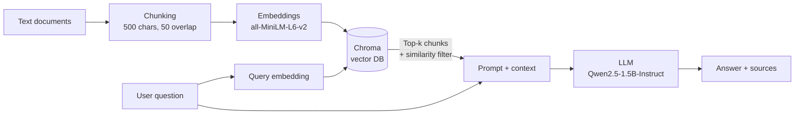

# RAG Question Answering over Documents

A modular **Retrieval-Augmented Generation (RAG)** pipeline that answers questions from a collection of text documents. It runs fully locally with open-source models, so no API keys are needed. Every answer is grounded in the retrieved passages and returned with its sources and similarity scores.

Built with **LangChain**, **ChromaDB**, **Sentence-Transformers** and **Qwen2.5-1.5B-Instruct**, with a **Gradio** web interface.

## How it works



1. **Load:** read all `.txt` files from `data/`.
2. **Chunk:** split them into 500-character chunks with a 50-character overlap, each tagged with its source file and chunk ID.
3. **Embed and store:** encode the chunks with `all-MiniLM-L6-v2` and store them in a persistent Chroma index (cosine similarity).
4. **Retrieve:** embed the question and fetch the top-k most similar chunks, dropping any below a minimum similarity score.
5. **Generate:** build a grounded prompt ("answer only from the context, otherwise say *I don't know*") and generate the answer with Qwen2.5-1.5B-Instruct.
6. **Cite:** return the answer with the file, chunk ID and score of every passage used.

## Project structure

| File | Role |
|---|---|
| `c1_load_documents.py` | Loads `.txt` documents from a folder |
| `c2_chunking.py` | Fixed-size chunking with overlap and chunk metadata |
| `c3_embed_store.py` | Embedding model and Chroma vector store |
| `c4_retrieve.py` | Top-k retrieval with similarity scores |
| `c5_prompt_builder.py` | Builds the grounded prompt within a context budget |
| `c6_llm.py` | Local Hugging Face LLM wrapper with output cleaning |
| `ingest.py` | Builds the vector index (load → chunk → embed → store) |
| `main.py` | Command-line demo: asks one question and prints the answer and sources |
| `app.py` | Gradio web UI with adjustable `TOP_K` and `MIN_SCORE` |
| `data/` | Sample corpus (AI history, ML, LLMs, quantum computing, climate, space) |

Each `c*.py` module can be run on its own to inspect that stage of the pipeline.

## Getting started

```bash
git clone https://github.com/<your-username>/rag-qa-pipeline.git
cd rag-qa-pipeline

python -m venv .venv
source .venv/bin/activate        # Windows: .venv\Scripts\activate
pip install -r requirements.txt

python ingest.py                 # build the vector index (first run downloads the embedding model)
python main.py                   # command-line demo
python app.py                    # web UI at http://127.0.0.1:7860
```

The first run downloads the models from Hugging Face (about 3 GB for the LLM). A GPU is used automatically if one is available; otherwise it runs on the CPU, more slowly. To get a temporary public link for the web UI, run `GRADIO_SHARE=1 python app.py`.

To use your own documents, put `.txt` files in `data/` and run `python ingest.py` again.

## Configuration

| Setting | Where | Default |
|---|---|---|
| Chunk size / overlap | `ingest.py` | 500 / 50 characters |
| Embedding model | `c3_embed_store.py` | `sentence-transformers/all-MiniLM-L6-v2` |
| LLM | `c6_llm.py` | `Qwen/Qwen2.5-1.5B-Instruct` |
| Top-k and minimum similarity | sliders in `app.py` | 3 and 0.5 |

## Tech stack

Python · LangChain · ChromaDB · Sentence-Transformers · Hugging Face Transformers · PyTorch · Gradio

## Author

Aiman Basharat Abbasi, MSc International Biometrics & Intelligent Vision, Université Paris-Est Créteil (UPEC)
